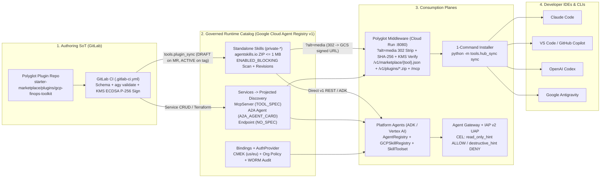

# Enterprise Agent Marketplace Workshop (Google Cloud Agent Registry `v1`)

Build a **governed, multi-IDE Enterprise Agent Marketplace** backed by **Google Cloud Agent Registry (`v1` GA)** that serves **Skills (`agentskills.io`)**, **MCP Servers (`TOOL_SPEC`)**, **A2A v1.0 Agents (`A2A_AGENT_CARD`)**, and **Endpoints** simultaneously to **Claude Code**, **OpenAI Codex**, **VS Code / GitHub Copilot**, **Google Antigravity**, and **Vertex AI / ADK Platform Agents**—with GitLab as the authoring Source of Truth and Agent Registry as the governed runtime catalog.

---

## Executive & Architecture Documentation

- **[Customer Use Case 3 Executive Brief](docs/customer-usecase-3-brief.md)** — Verified architectural Q&A answering all 4 enterprise design questions (`agent-plugins.org` vs `agentskills.io`, 4-IDE + ADK Developer/Platform UX, Governance/KMS/IAP/Audit, and GitLab vs. Agent Registry Dual-Role Source of Truth).
- **[Technical Architecture Deep Dive](docs/architecture.md)** — End-to-end Mermaid diagrams covering ingest decomposition, `?alt=media` HTTP 302 signed-URL header stripping, Polyglot 5-IDE single-bundle synthesis, safe ownership-tracked workstation hydration, and defense-in-depth security planes.
- **[Guided Starter Exercises](starter/README.md)** — Hands-on `# WORKSHOP-TODO` exercises for Labs 01–04 with built-in offline self-checks.
- **[Platform Agent Reference Guide](platform_agent/README.md)** — Direct Google ADK (`AgentRegistry` + `GCPSkillRegistry` + `SkillToolset`) and REST `v1` consumption patterns.

---

## End-to-End Architecture Overview



---

## Curriculum Structure: Two Modular Workstreams

This workshop is explicitly structured into **two independent workstreams**. Teams can run **Workstream A** for the complete platform & IDE marketplace build, run **Workstream B standalone** against either the local mock registry or any existing Google Cloud Agent Registry project, or combine both for a full-day enterprise blueprint.

### Workstream A — Core Platform, Middleware & Developer UX (Modules 0–5, ~3.5 hours)

| Module | Lab Guide | Duration | Focus & Hands-On Artifacts |
| :---: | :--- | :---: | :--- |
| **00** | [Environment Setup](docs/labs/00-environment-setup.md) | 20 min | `.venv` verification, 5-minute offline smoke test (`mock_registry`), and optional `terraform/core` GCP deployment |
| **01** | [Author a Polyglot Agent Plugin](docs/labs/01-author-agent-plugin.md) | 35 min | Authoring `gcp-finops-toolkit` (`agent-plugins.org` 1.0 + Antigravity `build-plugins` multi-tool coexistence, `rules/`, `assets/logo.svg`, `agy plugin validate --json` CI filter, `starter/lab01_plugin_skeleton/`) |
| **02** | [Register Assets in Agent Registry](docs/labs/02-register-agent-registry.md) | 35 min | Decomposing plugins with `python -m tools.plugin_sync` into `private-` Skills, `TOOL_SPEC` MCP Server, `A2A_AGENT_CARD` Agent (empty top-level `interfaces`), and Endpoint via `v1` REST / `gcloud` / Terraform |
| **03** | [Build & Deploy Polyglot Middleware](docs/labs/03-build-deploy-middleware.md) | 40 min | Cloud Run Polyglot Middleware (`?alt=media` 302 redirect header stripping, single-bundle ZIP synthesis, `/v1/marketplace/{claude,copilot,codex,antigravity}.json`, Streamable HTTP `/mcp` gateway) |
| **04** | [1-Command Multi-IDE Developer UX](docs/labs/04-ide-developer-experience.md) | 40 min | Zero-friction developer onboarding via `python -m tools.hub_sync` & Bootstrap `/mcp` across **Claude Code**, **OpenAI Codex**, **GitHub Copilot / VS Code**, and **Google Antigravity** (`agy plugin install`, `agy plugin list --json`, `agy --agent`) |
| **05** | [Platform Agents & GitLab Dual-SoT](docs/labs/05-platform-agents-gitlab-sot.md) | 40 min | Direct ADK consumption (`AgentRegistry` + `GCPSkillRegistry` + `SkillToolset`) via `python -m platform_agent.adk_orchestrator` and GitLab CI/CD pipeline ([starter-marketplace/.gitlab-ci.yml](starter-marketplace/.gitlab-ci.yml)) |

### Workstream B — Security & Governance Standalone Track (Modules 6–8, ~2 hours)

> **Standalone Ready:** Workstream B has **zero runtime dependency** on `terraform/core` state. Run Modules 6–8 directly against the local `mock_registry` (`make run-mock`) OR deploy `terraform/security_governance/` independently against any existing Agent Registry project.

| Module | Lab Guide | Duration | Focus & Hands-On Artifacts |
| :---: | :--- | :---: | :--- |
| **06** | [Governance, Scanning & Skill Lifecycle](docs/labs/06-governance-scanning-lifecycle.md) | 40 min | `TARGET_STATE_DRAFT` quarantine, `ENABLED_BLOCKING` scanning + triggering a real `SECRET` `Finding`, immutable `SkillRevision` promotion & rollback via `defaultRevision`, `DEPRECATED` → terminal `DECOMMISSIONED`, Publisher tiers, and Custom Org Policy Constraint |
| **07** | [Cloud KMS Encryption (CMEK) vs. Artifact Signing](docs/labs/07-kms-encryption-and-signing.md) | 40 min | Native CMEK (`SkillEncryptionSpec` in `us`/`eu` multi-regions + zero-skills precondition) vs. Cloud KMS Asymmetric Signing (`EC_SIGN_P256_SHA256`) in CI + Middleware tamper-rejection gate |
| **08** | [Access Control, Agent Gateway IAP & Audit](docs/labs/08-access-control-and-audit.md) | 40 min | 4 IAM roles (`viewer`, `user`, `editor`, `admin`), per-`Skill` IAM, `AuthProvider` + `Binding` + `FetchAvailableBindings`, Agent Gateway + IAP v2 UAP CEL (`read_only_hint` / `destructive_hint`), Antigravity `hooks.json` policy guard, and WORM Cloud Audit Log compliance queries |

---

## 5-Minute Quickstart

### Mode A: Local Offline Mode (Zero GCP Account Needed)

Verify the full test suite and HCL formatting first:

```bash
make test
make validate-hcl
```

Run the complete end-to-end enterprise marketplace stack locally across four terminals:

```bash
# Terminal 1 — Start the faithful local Agent Registry v1 simulator (port 8090)
make run-mock

# Terminal 2 — Start the FinOps MCP server (port 8091) and A2A v1.0 agent (port 8092)
make run-samples

# Terminal 3 — Start the Polyglot Marketplace Middleware (port 8080)
make run-middleware

# Terminal 4 — Sync the starter plugin into Agent Registry, then hydrate all 4 IDEs into a demo HOME
make demo-sync
make demo-hub-sync
```

Inspect the live endpoints immediately:

```bash
curl -fsSL http://127.0.0.1:8080/v1/catalog | .venv/bin/python -m json.tool
curl -fsSL http://127.0.0.1:8080/v1/marketplace/antigravity.json | .venv/bin/python -m json.tool
curl -fsSL http://127.0.0.1:8080/v1/marketplace/claude.json | .venv/bin/python -m json.tool
```

### Mode B: Live Google Cloud Deployment (Terraform GA `hashicorp/google >= 7.39.0`)

1. Copy and edit [terraform/core/terraform.tfvars.example](terraform/core/terraform.tfvars.example) to `terraform/core/terraform.tfvars` with your `project_id`, `location`, and Artifact Registry container images (see [Lab 00](docs/labs/00-environment-setup.md) and [Lab 03](docs/labs/03-build-deploy-middleware.md) for image build commands).
2. Preview and deploy Workstream A core infrastructure:
   ```bash
   make tf-core-plan
   terraform -chdir=terraform/core apply
   ```
3. Layer Workstream B security & governance (or deploy it standalone on an existing Agent Registry project) using [terraform/security_governance/terraform.tfvars.example](terraform/security_governance/terraform.tfvars.example):
   ```bash
   export TF_VAR_auth_provider_client_secret="<your-oauth-client-secret>"
   make tf-sec-plan
   terraform -chdir=terraform/security_governance apply
   ```

---

## Repository Map

| Path | Description |
| :--- | :--- |
| [WORKSHOP_SPEC.json](WORKSHOP_SPEC.json) | Canonical ports (`8090`, `8091`, `8092`, `8080`), resource names, URNs, metadata keys, and Terraform outputs |
| [Makefile](Makefile) | Developer & facilitator shortcuts (`test`, `test-e2e`, `validate-hcl`, `run-*`, `demo-*`, `tf-*-plan`) |
| [starter-marketplace/](starter-marketplace/.gitlab-ci.yml) | Reference GitLab plugin repository (`gcp-finops-toolkit`) and 3-stage `.gitlab-ci.yml` sync pipeline |
| [tools/plugin_sync/](tools/plugin_sync/cli.py) | CLI decomposing `agent-plugins.org` bundles into single-skill ZIPs, signing digests, and syncing to Agent Registry `v1` |
| [mock_registry/](mock_registry/app.py) | Faithful local simulator of `agentregistry.googleapis.com/v1` (incl. `private-` prefixing, blocking scanner, `?alt=media` 302 strict header checks) |
| [samples/](samples/mcp-server/app.py) | Runnable FinOps Streamable HTTP MCP server (`:8091`) and A2A v1.0 advisor agent (`:8092`) |
| [middleware/](middleware/app/main.py) | Cloud Run Polyglot Middleware projecting 4 IDE marketplace feeds, deterministic 5-IDE ZIP bundles, and Streamable HTTP `/mcp` gateway |
| [tools/hub_sync/](tools/hub_sync/cli.py) | 1-command developer workstation installer with atomic writes and ownership-tracked config hydration |
| [platform_agent/](platform_agent/README.md) | Dual-mode Google ADK (`AgentRegistry` + `GCPSkillRegistry`) and REST `v1` platform agent orchestrator |
| [schemas/](schemas/validators.py) | Official JSON Schemas and validators for Agent Plugins 1.0, Antigravity `v1`, Claude Code, Copilot, and Codex |
| [terraform/core/](terraform/core/agent_registry_services.tf) | Workstream A GA Terraform: APIs, least-privilege SAs, Artifact Registry, GCS staging, Cloud Run, `Service` registrations, and Skills bootstrap |
| [terraform/security_governance/](terraform/security_governance/kms.tf) | Workstream B standalone GA Terraform: CMEK + Asymmetric Signing KMS, `AuthProvider` + `Binding`, Agent Gateway + IAP, Org Policy, and WORM audit bucket |
| [security-governance/](security-governance/audit/compliance-queries.md) | Standalone KMS signing CLI, IAM v3 UAP tool-annotation policies, Org Policy YAMLs, Antigravity policy-guard hooks, and Cloud Logging / BigQuery compliance queries |
| [starter/](starter/README.md) | Hands-on `# WORKSHOP-TODO` coding exercises for Labs 01–04 |
| [docs/](docs/architecture.md) | Executive brief, architecture deep dive, and Labs 00–08 |
