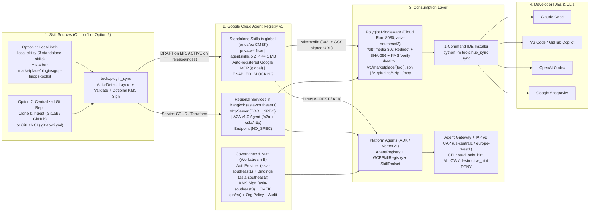

# Enterprise Agent Marketplace Workshop (Google Cloud Agent Registry `v1`)

Build a governed, multi-IDE agent marketplace backed by Google Cloud Agent Registry (`v1` GA). Publish Skills (`agentskills.io`), MCP Servers (`TOOL_SPEC`), A2A v1.0 Agents (`A2A_AGENT_CARD`), and Endpoints once, then serve them to Claude Code, OpenAI Codex, VS Code / GitHub Copilot, Google Antigravity, and Vertex AI / ADK agents.

GitLab stays your authoring source of truth. Agent Registry acts as the scanned, governed runtime catalog.

---

## Start Here: Three Content Folders

This repo has three top-level content folders. Knowing which one to edit saves time from Lab 01 onward:

| Folder | Role | What's Inside |
| :--- | :--- | :--- |
| [`starter/`](starter/README.md) | **Your hands-on exercises** | Incomplete plugin skeleton and `# WORKSHOP-TODO` Python files you edit in Labs 01–04. |
| [`starter-marketplace/`](starter-marketplace/plugins/gcp-finops-toolkit/plugin.json) | **Working reference plugin repo** | Complete `gcp-finops-toolkit` multi-IDE plugin and push-based [`.gitlab-ci.yml`](starter-marketplace/.gitlab-ci.yml). Peek here if you get stuck. |
| [`local-skills/`](local-skills/README.md) | **Ready-to-sync standalone skills** | Three `agentskills.io` skills (`cloud-run-debugger`, `terraform-iam-auditor`, `incident-postmortem-writer`) ready to upload immediately. |

---

## Key Docs

- **[Attendee Quickstart & Cheat Sheet](docs/attendee-quickstart.md):** Pick your laptop track (Track 1 Local, Track 2 `gcloud` + Cloud Build, or Track 3 Terraform), check the APAC region table, port map, and `Makefile` shortcuts.
- **[Guided Starter Exercises](starter/README.md):** Exact files, function names, self-check commands (`make starter-check`), and reference solutions for Labs 01–04, plus what Labs 05–08 use instead.
- **[Customer Use Case 3 Executive Brief](docs/customer-usecase-3-brief.md):** Direct answers to the four enterprise design questions (`agent-plugins.org` vs. `agentskills.io`, multi-IDE + ADK UX, governance/KMS/IAP/audit, and GitLab vs. Agent Registry roles).
- **[Technical Architecture](docs/architecture.md):** End-to-end diagrams for skill ingest, `?alt=media` HTTP 302 redirect handling, 5-IDE ZIP synthesis, APAC regional placement, and safe IDE config sync.
- **[Platform Agent Guide](platform_agent/README.md):** Direct Google ADK (`AgentRegistry`, `GCPSkillRegistry`, `SkillToolset`) and REST `v1` consumer examples.

---

## Architecture at a Glance



---

## Curriculum: Two Modular Workstreams

Run **Workstream A** for the core platform and IDE marketplace build. Run **Workstream B** on its own against the local mock registry or any existing GCP project, or run both together.

### Workstream A: Core Platform, Middleware & IDE UX (Labs 00–05, ~3.5 hours)

| Lab | Guide | Duration | Starter / Hands-On Files | What You Build |
| :---: | :--- | :---: | :--- | :--- |
| **00** | [Environment Setup](docs/labs/00-environment-setup.md) | 20 min | *Setup only:* `WORKSHOP_SPEC.json`, `Makefile`, `scripts/preflight_check.sh` | Verify `.venv`, pass `make preflight` and `make test`, run `make smoke-local`, and start the local stack. |
| **01** | [Author a Polyglot Agent Plugin](docs/labs/01-author-agent-plugin.md) | 35 min | **Edit:** `starter/lab01_plugin_skeleton/` (add 6 Antigravity files)<br>**Inspect:** `starter-marketplace/plugins/gcp-finops-toolkit/`, `local-skills/` | Build a 5-IDE plugin bundle that passes `agent-plugins.org` 1.0 and Antigravity `v1` checks, plus tour standalone skills. |
| **02** | [Register Assets in Agent Registry](docs/labs/02-register-agent-registry.md) | 35 min | **Edit:** `starter/lab02_plugin_sync_exercise.py` (4 TODOs)<br>**Run:** `tools/plugin_sync/cli.py`, `make demo-sync-local` | Package single-`SKILL.md` ZIPs with `private-` IDs, sync local or Git skills into `global`, and register Bangkok (`asia-southeast3`) Services. |
| **03** | [Build & Deploy Polyglot Middleware](docs/labs/03-build-deploy-middleware.md) | 40 min | **Edit:** `starter/lab03_middleware_redirect_exercise.py` (3 TODOs)<br>**Run:** `middleware/app/main.py`, `scripts/deploy_gcp.sh` | Fix the `?alt=media` 302 redirect header bug, assemble 5-IDE ZIPs, call `/mcp`, and optionally deploy to Bangkok Cloud Run via Cloud Build. |
| **04** | [1-Command Multi-IDE Developer UX](docs/labs/04-ide-developer-experience.md) | 40 min | **Edit:** `starter/lab04_hub_sync_adapter_exercise.py` (2 TODOs)<br>**Run:** `tools/hub_sync/cli.py`, `make demo-hub-sync` | Implement atomic JSON writes and safe config merging, then install plugins across Claude Code, Codex, Copilot, and Antigravity without clobbering personal settings. |
| **05** | [Platform Agents & GitLab Dual-SoT](docs/labs/05-platform-agents-gitlab-sot.md) | 40 min | *No `starter/` stub.* **Run/Inspect:** `platform_agent/adk_orchestrator.py`, `starter-marketplace/.gitlab-ci.yml`, `scripts/validate_live_gcp.sh` | Connect ADK / REST platform agents directly to Agent Registry, simulate GitLab MR vs. tag CI flows, and run live GCP validation & teardown. |

### Workstream B: Security & Governance Standalone Track (Labs 06–08, ~2 hours)

> **Standalone Ready:** Workstream B does not need `terraform/core` state. Run Labs 06–08 locally against `mock_registry` (`make run-mock`) or deploy `terraform/security_governance/` against any existing Agent Registry project.

| Lab | Guide | Duration | Starter / Hands-On Files | What You Build |
| :---: | :--- | :---: | :--- | :--- |
| **06** | [Governance, Scanning & Skill Lifecycle](docs/labs/06-governance-scanning-lifecycle.md) | 40 min | *No `starter/` stub.* **Run/Inspect:** `mock_registry/app.py`, `security-governance/org-policy/*.yaml`, `terraform/security_governance/org_policy.tf` | Trigger `ENABLED_BLOCKING` `SECRET` findings, promote and roll back `SkillRevision` versions via `defaultRevision`, walk to terminal `DECOMMISSIONED`, and enforce Org Policy. |
| **07** | [Cloud KMS Encryption (CMEK) vs. Artifact Signing](docs/labs/07-kms-encryption-and-signing.md) | 40 min | *No `starter/` stub.* **Run/Inspect:** `security-governance/kms/sign_and_verify.py`, `middleware/app/security_verifier.py`, `terraform/security_governance/kms.tf` | Separate CMEK at-rest encryption (`us`/`eu`) from ECDSA P-256 signing (`asia-southeast3`), sign a skill ZIP, and watch Middleware reject a tampered upload. |
| **08** | [Access Control, Agent Gateway IAP & Audit](docs/labs/08-access-control-and-audit.md) | 40 min | *No `starter/` stub.* **Run/Inspect:** `security-governance/iap-uap/`, `security-governance/hooks/scripts/policy_guard.py`, `security-governance/audit/compliance-queries.md` | Test IAM roles, `AuthProvider` (`asia-southeast1`) + `Binding`, IAP v2 UAP CEL rules, client-side hook guards, and WORM Cloud Audit queries. |

---

## Two Ways to Ingest Skills

Both paths load the same Agent Registry catalog, Middleware feeds, IDE installer (`tools.hub_sync`), and ADK agents:

| Path | Best For | Source Content | CLI / Make Target | Terraform (`terraform/core/`) |
| :--- | :--- | :--- | :--- | :--- |
| **Option 1: Local Skills** *(Default)* | Classroom workshops and offline demos (no Git tokens needed) | [`local-skills/`](local-skills/README.md) (`local-ops-toolkit`) + [`starter-marketplace/`](starter-marketplace/plugins/gcp-finops-toolkit/plugin.json) (`gcp-finops-toolkit`) | `make demo-sync-local`<br>`python -m tools.plugin_sync ingest --source-type local --path local-skills --plugin-name local-ops-toolkit` | `skills_source_mode = "local"` |
| **Option 2: Centralized Git Repo** | Bring-your-own GitLab or GitHub repo without restructuring | Any Git repo (`single_plugin`, `multi_plugin`, `single_skill`, `standalone_skills`, or `hybrid` layout with repo + commit metadata) | `make demo-sync-repo`<br>`python -m tools.plugin_sync ingest --source-type git --repo-url <url> --ref main` | `skills_source_mode = "git"` |

Once a catalog works locally, move to push-based CI with [`starter-marketplace/.gitlab-ci.yml`](starter-marketplace/.gitlab-ci.yml) so MRs quarantine as `TARGET_STATE_DRAFT` and release tags publish as `TARGET_STATE_ACTIVE` (see [Lab 05](docs/labs/05-platform-agents-gitlab-sot.md)).

---

## 5-Minute Quickstart

Pick the track that matches your laptop. No local Docker is required for any track. See the [Attendee Quickstart](docs/attendee-quickstart.md) for the full decision tree and APAC region table.

### Track 1: Offline Local Mode (No GCP Account, No Docker, No Terraform)

Run preflight, tests, the offline smoke check, and the starter progress report:

```bash
make preflight
make test
make smoke-local
make starter-check
```

Start the local stack in one terminal (`:8090` Mock Registry, `:8091` MCP Server, `:8092` A2A Agent, `:8080` Middleware):

```bash
make run-local-stack
```

Then open a second terminal to sync skills and install configs for all four IDEs into a temporary demo `$HOME`:

```bash
# Option 1 (default offline): gcp-finops-toolkit + local-skills/
make demo-sync-local
# Or Option 2 (clone & ingest a Git repo): make demo-sync-repo

# Install plugins and MCP configs into /tmp/acme-agent-hub-demo-home
make demo-hub-sync

# Inspect live Middleware feeds
curl -fsSL http://127.0.0.1:8080/v1/catalog | .venv/bin/python -m json.tool
curl -fsSL http://127.0.0.1:8080/v1/marketplace/antigravity.json | .venv/bin/python -m json.tool
curl -fsSL http://127.0.0.1:8080/v1/marketplace/claude.json | .venv/bin/python -m json.tool
```

*(Prefer separate log windows? Run `make run-mock`, `make run-samples`, and `make run-middleware` in three terminals instead of `make run-local-stack`.)*

### Track 2: Live GCP with `gcloud` + Cloud Build (No Local Docker or Terraform)

Live deployments anchor in **Bangkok (`asia-southeast3`)** with two API-required placements:
- **Standalone `Skills`:** live in `global` (filtered to `private-` IDs so built-in Google skills stay out of your enterprise feed).
- **Workstream B Agent Identity `AuthProvider`:** uses `auth_provider_location = "asia-southeast1"` (Singapore) because Agent Identity is not yet available in Bangkok.
- **Full region table:** see [Attendee Quickstart](docs/attendee-quickstart.md#2-apac-region-guide) for `us`/`eu` CMEK and `us-central1`/`europe-west1` Agent Gateway details.

```bash
export GCP_PROJECT_ID="<your-gcp-project-id>"

# Build via Cloud Build, deploy Cloud Run & Services in asia-southeast3, and sync Skills to global
make gcp-deploy GCP_PROJECT_ID="${GCP_PROJECT_ID}"

# Validate live Cloud Run (/health), Agent Registry resources, and 4-IDE feeds
make gcp-validate GCP_PROJECT_ID="${GCP_PROJECT_ID}"

# Tear down workshop resources when done
make gcp-destroy GCP_PROJECT_ID="${GCP_PROJECT_ID}"
```

### Track 3: Live GCP with Cloud Build + Terraform (`hashicorp/google >= 7.39.0`)

1. **Stage 1 (Configure variables, enable APIs & Artifact Registry, then build images):** Copy [`terraform/core/terraform.tfvars.example`](terraform/core/terraform.tfvars.example) to `terraform/core/terraform.tfvars` and replace `acme-agent-governance` with your GCP project ID in `project_id`, `middleware_image`, `sample_mcp_image`, and `sample_a2a_image` (keeping `:1.0.0`, `location = "asia-southeast3"`, and `skills_location = "global"`). Then enable APIs and create the Artifact Registry repository with Terraform before running Cloud Build so Terraform owns the repo and Cloud Run v2 finds the pushed images:
   ```bash
   export GCP_PROJECT_ID="<your-gcp-project-id>"

   # Stage 1A: Enable APIs and create the Bangkok Artifact Registry repository
   terraform -chdir=terraform/core init
   terraform -chdir=terraform/core apply \
     -target=google_project_service.core \
     -target=google_artifact_registry_repository.workshop_images

   # Stage 1B: Build and push all 3 container images via Cloud Build
   scripts/build_images_cloudbuild.sh --project "${GCP_PROJECT_ID}" --region asia-southeast3
   ```
2. **Stage 2 (Apply Workstream A core stack):** Validate HCL, review the plan, and deploy Cloud Run, Bangkok Agent Registry `Services`, and scanned `global` skills:
   ```bash
   make validate-hcl
   make tf-core-plan
   terraform -chdir=terraform/core apply
   ```
3. **Optional Workstream B (Standalone Security & Governance):** Copy [`terraform/security_governance/terraform.tfvars.example`](terraform/security_governance/terraform.tfvars.example) (`location = "asia-southeast3"`, `auth_provider_location = "asia-southeast1"`, `enable_agent_gateway = false`, `lock_audit_bucket = false`), then run:
   ```bash
   export TF_VAR_auth_provider_client_secret="<your-oauth-client-secret>"
   make tf-sec-plan
   terraform -chdir=terraform/security_governance apply
   ```

---

## Antigravity Workspace Skills (`.agents/skills/`)

When you open this repository in Google Antigravity, it loads five workspace skills from [.agents/skills/](.agents/skills/) as `/<skill-name>` workflows. These assist you while working on the repo and stay separate from the sample catalog payloads in [local-skills/](local-skills/README.md) and [starter-marketplace/](starter-marketplace/plugins/gcp-finops-toolkit/plugin.json).

| Slash Command | When to Use | What It Covers |
| :--- | :--- | :--- |
| [`/agent-marketplace-workshop-guide`](.agents/skills/agent-marketplace-workshop-guide/SKILL.md) | Starting out, picking a track, or troubleshooting setup | Workstream A vs. standalone Workstream B routing, `make preflight`, local stack startup, coaching `starter/` TODOs, and mapping Use Case 3 to Terraform. |
| [`/polyglot-agent-plugin-authoring`](.agents/skills/polyglot-agent-plugin-authoring/SKILL.md) | Lab 01 or authoring new multi-IDE plugins | Validating `plugin.json`, `.antigravity-plugin/plugin.json`, `mcp_config.json`, `SKILL.md`, `rules/`, `hooks.json`, and `agy plugin validate --json` CI gates. |
| [`/agent-registry-v1-ingest-and-lifecycle`](.agents/skills/agent-registry-v1-ingest-and-lifecycle/SKILL.md) | Labs 02, 05, 06, or operating Agent Registry `v1` | Running `tools.plugin_sync ingest` across local/Git layouts, `private-` IDs, `TOOL_SPEC` / `A2A_AGENT_CARD`, `skills_source_mode`, `Finding` triage, and `defaultRevision` rollbacks. |
| [`/marketplace-middleware-and-ide-delivery`](.agents/skills/marketplace-middleware-and-ide-delivery/SKILL.md) | Labs 03–05 or rolling out IDE delivery | Debugging `?alt=media` 302 redirects, 5-IDE ZIP assembly, `/mcp` tools, atomic `.sync-manifest.json` config merges, Cloud Run deploys, and ADK/REST agents. |
| [`/agent-registry-security-and-prod-hardening`](.agents/skills/agent-registry-security-and-prod-hardening/SKILL.md) | Workstream B (Labs 06–08) or production go-live | Cloud KMS CMEK vs. `EC_SIGN_P256_SHA256` signing, `AuthProvider` + `Binding`, IAP v2 UAP CEL, `hooks.json` policy guards, Org Policy, and WORM audit logs. |

---

## Repository Map

| Path | What's Inside |
| :--- | :--- |
| [WORKSHOP_SPEC.json](WORKSHOP_SPEC.json) | Canonical ports (`8090`, `8091`, `8092`, `8080`), APAC region defaults, resource names, URNs, and metadata keys. |
| [Makefile](Makefile) | Shortcuts for setup, tests, local servers, skill sync, IDE install, Cloud Build/GCP deploy, and Terraform plans. |
| `scripts/`, `cloudbuild/`, `.gcloudignore` | Preflight script (`scripts/preflight_check.sh`), starter verifier (`scripts/check_starter.py`), local stack runner, Cloud Build configs (`cloudbuild/*.yaml`), and Bangkok GCP lifecycle scripts. |
| [.agents/skills/](.agents/skills/) | Five auto-discovered Antigravity workspace skills for workshop coaching and production operations. |
| [starter/](starter/README.md) | Your hands-on `# WORKSHOP-TODO` exercises for Labs 01–04. |
| [starter-marketplace/](starter-marketplace/.gitlab-ci.yml) | Working reference plugin (`gcp-finops-toolkit`) and 3-stage GitLab CI sync pipeline. |
| [local-skills/](local-skills/README.md) | Ready-to-sync standalone `agentskills.io` skills (`cloud-run-debugger`, `terraform-iam-auditor`, `incident-postmortem-writer`). |
| [tools/plugin_sync/](tools/plugin_sync/cli.py) | CLI for packaging local or Git skill repos (`sync` and `ingest`), signing digests, and uploading to Agent Registry `v1`. |
| [mock_registry/](mock_registry/app.py) | Local simulator of `agentregistry.googleapis.com/v1` (supports `private-` IDs, blocking scans, and strict `?alt=media` 302 header checks). |
| [samples/](samples/mcp-server/app.py) | Runnable FinOps MCP server (`:8091`) and A2A v1.0 advisor agent (`:8092`). |
| [middleware/](middleware/app/main.py) | Polyglot Middleware serving `/v1/catalog`, 4 IDE marketplace JSON feeds, 5-IDE plugin ZIPs, and `/mcp`. |
| [tools/hub_sync/](tools/hub_sync/cli.py) | 1-command IDE installer with atomic writes and ownership-tracked config merging. |
| [platform_agent/](platform_agent/README.md) | Direct Google ADK (`AgentRegistry`, `GCPSkillRegistry`) and REST `v1` platform agent examples. |
| [schemas/](schemas/validators.py) | JSON Schemas and validators for Agent Plugins 1.0, Antigravity `v1`, Claude Code, Copilot, and Codex. |
| [terraform/core/](terraform/core/agent_registry_services.tf) | Workstream A GA Terraform for APIs, IAM, Artifact Registry, GCS staging, Cloud Run, Services, and Skills bootstrap. |
| [terraform/security_governance/](terraform/security_governance/kms.tf) | Workstream B standalone GA Terraform for KMS CMEK/signing, `AuthProvider` + `Binding`, Agent Gateway + IAP, Org Policy, and audit logs. |
| [security-governance/](security-governance/audit/compliance-queries.md) | KMS signing CLI, IAP v2 UAP CEL policies, Org Policy YAMLs, hook policy guard, and Cloud Logging / BigQuery compliance queries. |
| [docs/](docs/attendee-quickstart.md) | Quickstart cheat sheet, executive brief, technical architecture, and Labs 00–08. |
