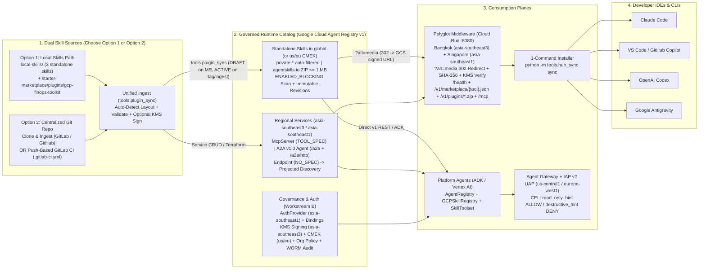

# Enterprise Agent Marketplace Workshop (Google Cloud Agent Registry `v1`)

Build a **governed, multi-IDE Enterprise Agent Marketplace** backed by **Google Cloud Agent Registry (`v1` GA)** that serves **Skills (`agentskills.io`)**, **MCP Servers (`TOOL_SPEC`)**, **A2A v1.0 Agents (`A2A_AGENT_CARD`)**, and **Endpoints** simultaneously to **Claude Code**, **OpenAI Codex**, **VS Code / GitHub Copilot**, **Google Antigravity**, and **Vertex AI / ADK Platform Agents**—with GitLab as the authoring Source of Truth and Agent Registry as the governed runtime catalog.

---

## Executive & Architecture Documentation

- **[Attendee Quickstart & Cheat Sheet](docs/attendee-quickstart.md)** — **Start here!** 1-page laptop decision tree (Track 1 Offline Local, Track 2 Zero-Docker/Zero-Terraform `gcloud` + Cloud Build, Track 3 Full Terraform IaC), verified **Bangkok (`asia-southeast3`) + Singapore (`asia-southeast1`) + `global` Skills** regional split matrix, port map, and 1-command `Makefile` reference.
- **[Customer Use Case 3 Executive Brief](docs/customer-usecase-3-brief.md)** — Verified architectural Q&A answering all 4 enterprise design questions (`agent-plugins.org` vs `agentskills.io`, 4-IDE + ADK Developer/Platform UX, Governance/KMS/IAP/Audit, and GitLab vs. Agent Registry Dual-Role Source of Truth).
- **[Technical Architecture Deep Dive](docs/architecture.md)** — End-to-end Mermaid diagrams covering ingest decomposition, `?alt=media` HTTP 302 signed-URL header stripping, Polyglot 5-IDE single-bundle synthesis, Bangkok/Singapore multi-region failover, safe ownership-tracked workstation hydration, and defense-in-depth security planes.
- **[Guided Starter Exercises](starter/README.md)** — Hands-on `# WORKSHOP-TODO` exercises for Labs 01–04 with 1-command `make starter-check` offline self-checks (100% zero-Docker).
- **[Platform Agent Reference Guide](platform_agent/README.md)** — Direct Google ADK (`AgentRegistry` + `GCPSkillRegistry` + `SkillToolset`) and REST `v1` consumption patterns.

---

## Antigravity Workspace Skills (`.agents/skills/`)

Opening this repository in **Google Antigravity** (App, CLI, or IDE) automatically discovers and loads all five workspace skills under `.agents/skills/` as `/<skill-name>` workflows with zero extra installation—keeping developer-assistance skills cleanly separate from the sample catalog payloads in [local-skills/](local-skills/README.md) and [starter-marketplace/](starter-marketplace/plugins/gcp-finops-toolkit/plugin.json) that you upload into Agent Registry.

| Slash Command & Skill | Workshop Use | Active Development Use | Production Rollout Use |
| :--- | :--- | :--- | :--- |
| [`/agent-marketplace-workshop-guide`](.agents/skills/agent-marketplace-workshop-guide/SKILL.md) | Choose Workstream A (Labs 00–05) or standalone Workstream B (Labs 06–08), run pre-flight & 4-terminal local stack, coach `starter/` `# WORKSHOP-TODO` exercises, verify checkpoints | Pick Option 1 (`make demo-sync-local`) vs. Option 2 (`make demo-sync-repo`) and troubleshoot local mock or schema errors rapidly | Map Customer Use Case 3 questions to Terraform modules (`terraform/core/`, `terraform/security_governance/`) and preview live plans |
| [`/polyglot-agent-plugin-authoring`](.agents/skills/polyglot-agent-plugin-authoring/SKILL.md) | Complete Lab 01 (`gcp-finops-toolkit`, `starter/lab01_plugin_skeleton/`, and `local-skills/` standalone skills) | Author & validate 5-IDE manifests (`plugin.json`, `.antigravity-plugin/plugin.json`, `mcp_config.json`, `SKILL.md`, `rules/`, `hooks.json`, A2A cards) via `schemas.validators` | Enforce all 7 Antigravity Pre-Publish checks and the `agy plugin validate --json` multi-tool `jq` gate in CI |
| [`/agent-registry-v1-ingest-and-lifecycle`](.agents/skills/agent-registry-v1-ingest-and-lifecycle/SKILL.md) | Complete Lab 02 & Lab 05 ingestion against `:8090` or live GCP, plus Lab 06 lifecycle transitions | Use `tools.plugin_sync ingest` across all 5 auto-detected local/Git layouts, `private-` skill IDs, `TOOL_SPEC` / `A2A_AGENT_CARD` specs, and `--only-skills` ownership rules | Operate `gcloud agent-registry`, `terraform/core` (`skills_source_mode`), `ENABLED_BLOCKING` `Finding` triage, atomic `defaultRevision` rollbacks, and standalone GitLab CI |
| [`/marketplace-middleware-and-ide-delivery`](.agents/skills/marketplace-middleware-and-ide-delivery/SKILL.md) | Complete Labs 03–05 (`middleware/`, `tools.hub_sync`, and `platform_agent.adk_orchestrator`) | Debug `?alt=media` 302 redirect header stripping, deterministic 5-IDE ZIP synthesis, `/mcp` (`load_verified_skill`), atomic `.sync-manifest.json` merges, and ADK/REST consumers | Build & deploy `polyglot-middleware` to Cloud Run, roll out 4-IDE workstation hydration (`--bootstrap-mcp-only` or full sync), and wire Vertex AI / ADK platform agents |
| [`/agent-registry-security-and-prod-hardening`](.agents/skills/agent-registry-security-and-prod-hardening/SKILL.md) | Execute standalone Workstream B (Labs 06–08) offline against `mock_registry` or against an existing GCP project | Test Cloud KMS CMEK vs. `EC_SIGN_P256_SHA256` signing (`sign_and_verify.py`), `AuthProvider` + `Binding`, IAP v2 UAP CEL (`apply-uap.sh`), and `hooks.json` policy guards | Run the 8-gate Production Go-Live Readiness Checklist: hardened `.tfvars`, least-privilege IAM, Custom Org Policy, keyless GitLab OIDC/WIF, and locked WORM Cloud Audit Logs |

---

## End-to-End Architecture Overview



---

## Two Skill Source Paths (Choose Option 1 or Option 2)

This workshop supports **two first-class, equally supported ways** to populate Google Cloud Agent Registry (`v1`). Both paths feed the exact same governed catalog, Polyglot Middleware, 4-IDE installer (`tools.hub_sync`), and ADK platform agents:

| Path | Best For | Source Content | Make Target / CLI Command | Terraform Bootstrap (`terraform/core/`) |
| :--- | :--- | :--- | :--- | :--- |
| **Option 1: Local Skills Path** *(Default)* | Classroom workshops, air-gapped demos, zero external GitLab/GitHub credentials | Pre-prepared standalone skills in [local-skills/](local-skills/README.md) (`local-ops-toolkit`) **+** full `agent-plugins.org` bundle in [starter-marketplace/](starter-marketplace/plugins/gcp-finops-toolkit/plugin.json) (`gcp-finops-toolkit`) | `make demo-sync-local`<br>`python -m tools.plugin_sync ingest --source-type local --path local-skills --plugin-name local-ops-toolkit` | `skills_source_mode = "local"`<br>(`enable_local_standalone_skills = true`, `local_skills_dir = "../../local-skills"`) |
| **Option 2: Centralized Git Repo Path (Clone & Ingest)** | Customer Bring-Your-Own-Repo onboarding (GitLab / GitHub) without restructuring first | Any centralized Git repo — auto-detects `single_plugin`, `multi_plugin`, `single_skill`, `standalone_skills`, or `hybrid` layouts with exact 40-char `git_commit` provenance | `make demo-sync-repo` *(override `SKILLS_REPO_URL`, `SKILLS_REPO_REF`, `SKILLS_REPO_SUBDIR`, `SKILLS_REPO_TOKEN_ENV`)*<br>`python -m tools.plugin_sync ingest --source-type git --repo-url <url> --ref main` | `skills_source_mode = "git"`<br>(`skills_repo_url`, `skills_repo_ref`, `skills_repo_subdir`, `skills_repo_token_env`) |

> **Graduating to Push-Based CI/CD:** Once a team validates its catalog with Option 1 or Option 2, promote to push-based GitLab CI ([starter-marketplace/.gitlab-ci.yml](starter-marketplace/.gitlab-ci.yml)) for automated MR `TARGET_STATE_DRAFT` quarantine and release-tag `TARGET_STATE_ACTIVE` publication (see [Lab 05](docs/labs/05-platform-agents-gitlab-sot.md)).

---

## Curriculum Structure: Two Modular Workstreams

This workshop is explicitly structured into **two independent workstreams**. Teams can run **Workstream A** for the complete platform & IDE marketplace build, run **Workstream B standalone** against either the local mock registry or any existing Google Cloud Agent Registry project, or combine both for a full-day enterprise blueprint.

### Workstream A — Core Platform, Middleware & Developer UX (Modules 0–5, ~3.5 hours)

| Module | Lab Guide | Duration | Focus & Hands-On Artifacts |
| :---: | :--- | :---: | :--- |
| **00** | [Environment Setup](docs/labs/00-environment-setup.md) | 20 min | `.venv` verification, `make preflight`, 1-command offline smoke test (`make smoke-local` / `make run-local-stack`), and Live GCP authentication & pre-flight (no container builds yet) |
| **01** | [Author a Polyglot Agent Plugin](docs/labs/01-author-agent-plugin.md) | 35 min | Authoring `gcp-finops-toolkit` (`agent-plugins.org` 1.0 + Antigravity `build-plugins` multi-tool coexistence, `rules/`, `assets/logo.svg`, `agy plugin validate --json` CI filter, `starter/lab01_plugin_skeleton/`) plus standalone skills in `local-skills/` |
| **02** | [Register Assets in Agent Registry](docs/labs/02-register-agent-registry.md) | 35 min | Dual-source ingestion via `python -m tools.plugin_sync ingest` (**Option 1:** local `local-skills/` + `starter-marketplace/` via `make demo-sync-local`; **Option 2:** shallow-cloning a centralized GitLab/GitHub repo via `make demo-sync-repo`) targeting live `global` Skills (`--skills-location global`, `--wait-for-scan`) + regional `asia-southeast3`/`asia-southeast1` Services (`v1` REST, `gcloud`, and Terraform `skills_source_mode`) |
| **03** | [Build & Deploy Polyglot Middleware](docs/labs/03-build-deploy-middleware.md) | 40 min | Cloud Run Polyglot Middleware (`/health`, `?alt=media` 302 redirect auth/header handling, bounded concurrent skill verification, single-bundle ZIP synthesis, `/v1/marketplace/{claude,copilot,codex,antigravity}.json`, Streamable HTTP `/mcp`) + Zero-Docker Cloud Build (`cloudbuild/*.yaml`) deploy to **Bangkok (`asia-southeast3`)** primary & optional **Singapore (`asia-southeast1`)** secondary sharing **`global`** Skills |
| **04** | [1-Command Multi-IDE Developer UX](docs/labs/04-ide-developer-experience.md) | 40 min | Zero-friction developer onboarding via `python -m tools.hub_sync` (incl. Bangkok → Singapore `--fallback-middleware-url` failover) & Bootstrap `/mcp` across **Claude Code**, **OpenAI Codex**, **GitHub Copilot / VS Code**, and **Google Antigravity** (`agy plugin install`, `agy plugin list --json`, `agy --agent`) |
| **05** | [Platform Agents & GitLab Dual-SoT](docs/labs/05-platform-agents-gitlab-sot.md) | 40 min | Direct ADK consumption (`AgentRegistry` + `GCPSkillRegistry` + `SkillToolset`), GitLab CI/CD ([starter-marketplace/.gitlab-ci.yml](starter-marketplace/.gitlab-ci.yml)), plus Workstream A Live GCP Validation (`make gcp-validate`) & Cleanup Checkpoint (`make gcp-destroy`) |

### Workstream B — Security & Governance Standalone Track (Modules 6–8, ~2 hours)

> **Standalone Ready:** Workstream B has **zero runtime dependency** on `terraform/core` state. Run Modules 6–8 directly against the local `mock_registry` (`make run-mock`) OR deploy `terraform/security_governance/` independently against any existing Agent Registry project.

| Module | Lab Guide | Duration | Focus & Hands-On Artifacts |
| :---: | :--- | :---: | :--- |
| **06** | [Governance, Scanning & Skill Lifecycle](docs/labs/06-governance-scanning-lifecycle.md) | 40 min | `TARGET_STATE_DRAFT` quarantine, `ENABLED_BLOCKING` scanning + triggering a real `SECRET` `Finding`, immutable `SkillRevision` promotion & rollback via `defaultRevision`, `DEPRECATED` → terminal `DECOMMISSIONED`, Publisher tiers, and Custom Org Policy Constraint |
| **07** | [Cloud KMS Encryption (CMEK) vs. Artifact Signing](docs/labs/07-kms-encryption-and-signing.md) | 40 min | Native CMEK (`SkillEncryptionSpec` in `us`/`eu` multi-regions + zero-skills precondition) vs. Cloud KMS Asymmetric Signing (`EC_SIGN_P256_SHA256`) in CI + Middleware tamper-rejection gate |
| **08** | [Access Control, Agent Gateway IAP & Audit](docs/labs/08-access-control-and-audit.md) | 40 min | 4 IAM roles (`viewer`, `user`, `editor`, `admin`), per-`Skill` IAM, `AuthProvider` + `Binding` + `FetchAvailableBindings`, Agent Gateway + IAP v2 UAP CEL (`read_only_hint` / `destructive_hint`), Antigravity `hooks.json` policy guard, and WORM Cloud Audit Log compliance queries |

---

## 5-Minute Quickstart

Not sure which deployment path matches your laptop? Check the **[1-Page Attendee Quickstart & APAC Regional Matrix](docs/attendee-quickstart.md)**. **Zero local Docker is required for any track!**

### Track 1: Local Offline Mode (Zero GCP Account, Zero Docker, Zero Terraform)

Verify your environment, run the automated smoke test, and check starter exercises:

```bash
make preflight
make test
make smoke-local
make starter-check
```

Run the complete end-to-end enterprise marketplace stack locally — either in **one command** (`make run-local-stack`) or across four dedicated terminals:

```bash
# Single-terminal option: launches Mock Registry (:8090), Samples (:8091/:8092), and Middleware (:8080)
make run-local-stack

# OR 4-terminal interactive option:
# Terminal 1 — Start the faithful local Agent Registry v1 simulator (port 8090)
make run-mock

# Terminal 2 — Start the FinOps MCP server (port 8091) and A2A v1.0 agent (port 8092)
make run-samples

# Terminal 3 — Start the Polyglot Marketplace Middleware (port 8080)
make run-middleware

# Terminal 4 — Ingest skills into Agent Registry, then hydrate all 4 IDEs into a demo HOME
# Option 1 (Recommended offline default): starter plugin + pre-prepared local-skills/
make demo-sync-local
# Or Option 1 (starter plugin only): make demo-sync
# Or Option 2 (clone & ingest a centralized Git repo): make demo-sync-repo

make demo-hub-sync
```

Inspect the live endpoints immediately:

```bash
curl -fsSL http://127.0.0.1:8080/v1/catalog | .venv/bin/python -m json.tool
curl -fsSL http://127.0.0.1:8080/v1/marketplace/antigravity.json | .venv/bin/python -m json.tool
curl -fsSL http://127.0.0.1:8080/v1/marketplace/claude.json | .venv/bin/python -m json.tool
```

### Track 2: Live GCP — Zero Docker & Zero Terraform (`gcloud` + Cloud Build)

Deploy the entire Workstream A stack remotely via Cloud Build + Cloud Run to **Bangkok (`asia-southeast3`)** primary (and optional **Singapore (`asia-southeast1`)** secondary/DR failover) with **regional Agent Registry `Services` (`McpServer`, `Agent`, `Endpoint`)** in each deployed region and **standalone `Skills` shared once in `global`** (or `us`/`eu` for CMEK) — with zero local Docker or Terraform:

> **Verified Live APAC Regional Split:** Cloud Run, Cloud Build, Artifact Registry, and Agent Registry `Services` (`McpServer`, `Agent`, `Endpoint`) run regionally in **Bangkok (`asia-southeast3`)** (primary) and **Singapore (`asia-southeast1`)** (secondary/DR), while standalone **`Skills`** live in **`global`** (default `AGENT_REGISTRY_SKILLS_LOCATION=global`, or `us`/`eu` for CMEK) and are shared seamlessly by both regional Middlewares (automatically filtered to `private-*` skills so built-in Google first-party skills do not pollute enterprise catalogs). For Workstream B in APAC, host `AuthProvider` in **Singapore (`asia-southeast1`)**, Cloud KMS Asymmetric Signing (`EC_SIGN_P256_SHA256`) in **Bangkok (`asia-southeast3`)** / **Singapore (`asia-southeast1`)**, and keep `enable_agent_gateway = false` (currently `us-central1`/`europe-west1`).

```bash
export GCP_PROJECT_ID="<your-gcp-project-id>"

# Deploy primary Bangkok (asia-southeast3) + global Skills (ENABLE_SECONDARY defaults to false):
make gcp-deploy GCP_PROJECT_ID="${GCP_PROJECT_ID}"
# Or deploy Bangkok primary + Singapore (asia-southeast1) secondary/DR sharing global Skills:
make gcp-deploy GCP_PROJECT_ID="${GCP_PROJECT_ID}" ENABLE_SECONDARY=true
# (Direct script equivalent: scripts/deploy_gcp.sh --project "${GCP_PROJECT_ID}" --primary-region asia-southeast3 --skills-location global --enable-secondary)

# Validate live Cloud Run (/health), Agent Registry v1 regional Services + global Skills, and 4-IDE marketplace feeds
# (append ENABLE_SECONDARY=true if Singapore secondary was deployed):
make gcp-validate GCP_PROJECT_ID="${GCP_PROJECT_ID}" ENABLE_SECONDARY=true

# Always tear down workshop resources when finished to avoid idle cloud spend
make gcp-destroy GCP_PROJECT_ID="${GCP_PROJECT_ID}" ENABLE_SECONDARY=true
```

### Track 3: Live GCP — Full IaC (Zero-Docker Cloud Build + Terraform GA `hashicorp/google >= 7.39.0`)

1. **Stage 1 (Build images remotely first via Cloud Build — avoids fresh-project Terraform failures):**
   ```bash
   export GCP_PROJECT_ID="<your-gcp-project-id>"
   scripts/build_images_cloudbuild.sh --project "${GCP_PROJECT_ID}" --region asia-southeast3
   ```
2. **Stage 2 (Deploy Workstream A core infrastructure in Bangkok `asia-southeast3` + optional Singapore `asia-southeast1` secondary + shared `global` Skills):** Copy and edit [terraform/core/terraform.tfvars.example](terraform/core/terraform.tfvars.example) to `terraform/core/terraform.tfvars` (`location = "asia-southeast3"`, `secondary_location = "asia-southeast1"`, `skills_location = "global"`), verify HCL formatting, then preview and apply:
   ```bash
   make validate-hcl
   make tf-core-plan
   terraform -chdir=terraform/core apply
   ```
3. **Optional Workstream B (Standalone Security & Governance):** Layer on top of `terraform/core` or deploy standalone against any existing Agent Registry project using [terraform/security_governance/terraform.tfvars.example](terraform/security_governance/terraform.tfvars.example) (APAC defaults: `location = "asia-southeast3"`, `auth_provider_location = "asia-southeast1"`, `enable_agent_gateway = false`, `lock_audit_bucket = false` in sandboxes):
   ```bash
   export TF_VAR_auth_provider_client_secret="<your-oauth-client-secret>"
   make tf-sec-plan
   terraform -chdir=terraform/security_governance apply
   ```

---

## Repository Map

| Path | Description |
| :--- | :--- |
| [WORKSHOP_SPEC.json](WORKSHOP_SPEC.json) | Canonical ports (`8090`, `8091`, `8092`, `8080`), resource names, URNs, metadata keys, and Terraform outputs |
| [Makefile](Makefile) | Developer & facilitator shortcuts (`preflight`, `smoke-local`, `run-local-stack`, `starter-check`, `test`, `test-e2e`, `validate-hcl`, `run-*`, `demo-*`, `gcp-deploy`, `gcp-validate`, `gcp-destroy`, `tf-*-plan`) |
| `scripts/`, `cloudbuild/`, `.gcloudignore` | Zero-Docker Cloud Build configs (`cloudbuild/*.yaml`) + lean build-context ignore files (`.gcloudignore`/`.dockerignore`), environment pre-flight (`scripts/preflight_check.sh`), starter verifier (`scripts/check_starter.py`), and Bangkok/Singapore GCP lifecycle scripts (`build_images_cloudbuild.sh`, `deploy_gcp.sh`, `validate_live_gcp.sh`, `destroy_gcp.sh`) |
| [.agents/skills/](.agents/skills/) | Auto-discovered Google Antigravity workspace skills (`/agent-marketplace-workshop-guide`, `/polyglot-agent-plugin-authoring`, `/agent-registry-v1-ingest-and-lifecycle`, `/marketplace-middleware-and-ide-delivery`, `/agent-registry-security-and-prod-hardening`) for workshop, dev, and production workflows |
| [starter-marketplace/](starter-marketplace/.gitlab-ci.yml) | Reference GitLab plugin repository (`gcp-finops-toolkit`) and 3-stage `.gitlab-ci.yml` sync pipeline |
| [local-skills/](local-skills/README.md) | Option 1 pre-prepared standalone `agentskills.io` skills (`cloud-run-debugger`, `terraform-iam-auditor`, `incident-postmortem-writer`) for zero-friction local ingestion |
| [tools/plugin_sync/](tools/plugin_sync/cli.py) | CLI decomposing `agent-plugins.org` bundles and auto-discovering local or cloned Git skill repos (`sync` & `ingest`), signing digests, and registering into Agent Registry `v1` |
| [mock_registry/](mock_registry/app.py) | Faithful local simulator of `agentregistry.googleapis.com/v1` (incl. `private-` prefixing, blocking scanner, `?alt=media` 302 strict header checks) |
| [samples/](samples/mcp-server/app.py) | Runnable FinOps Streamable HTTP MCP server (`:8091`) and A2A v1.0 advisor agent (`:8092`) |
| [middleware/](middleware/app/main.py) | Cloud Run Polyglot Middleware projecting 4 IDE marketplace feeds, deterministic 5-IDE ZIP bundles, and Streamable HTTP `/mcp` gateway |
| [tools/hub_sync/](tools/hub_sync/cli.py) | 1-command developer workstation installer with atomic writes and ownership-tracked config hydration |
| [platform_agent/](platform_agent/README.md) | Dual-mode Google ADK (`AgentRegistry` + `GCPSkillRegistry`) and REST `v1` platform agent orchestrator |
| [schemas/](schemas/validators.py) | Official JSON Schemas and validators for Agent Plugins 1.0, Antigravity `v1`, Claude Code, Copilot, and Codex |
| [terraform/core/](terraform/core/agent_registry_services.tf) | Workstream A GA Terraform: APIs, least-privilege SAs, Artifact Registry, GCS staging, Cloud Run, `Service` registrations, and Skills bootstrap |
| [terraform/security_governance/](terraform/security_governance/kms.tf) | Workstream B standalone GA Terraform: CMEK + Asymmetric Signing KMS, `AuthProvider` + `Binding`, Agent Gateway + IAP, Org Policy, and WORM audit bucket |
| [security-governance/](security-governance/audit/compliance-queries.md) | Standalone KMS signing CLI, IAM v3 UAP tool-annotation policies, Org Policy YAMLs, Antigravity policy-guard hooks, and Cloud Logging / BigQuery compliance queries |
| [starter/](starter/README.md) | Hands-on `# WORKSHOP-TODO` coding exercises for Labs 01–04 |
| [docs/](docs/attendee-quickstart.md) | Attendee quickstart cheat sheet, executive brief, architecture deep dive, and Labs 00–08 |
