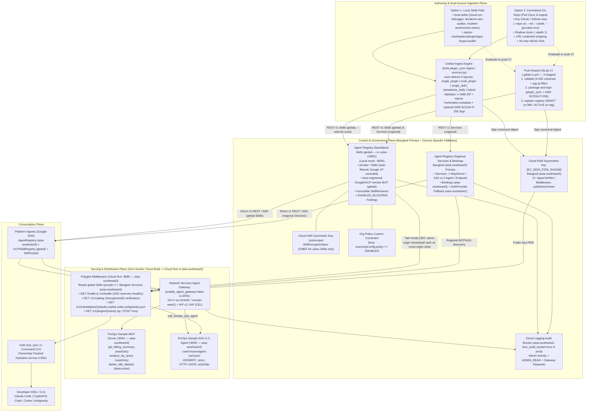
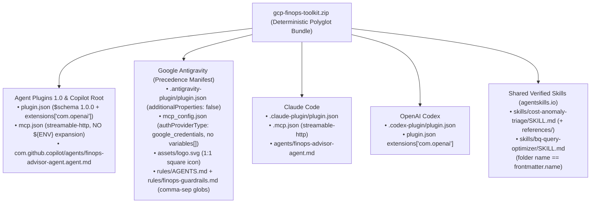
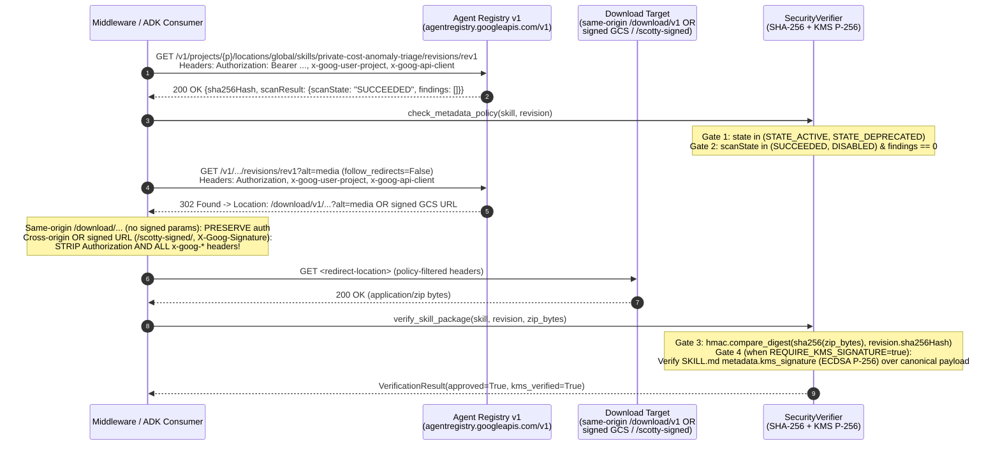
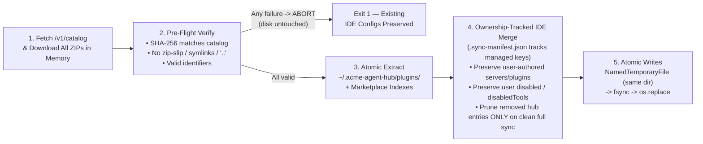
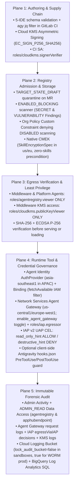

# Technical Architecture: Governed Polyglot Enterprise Agent Marketplace

This document details the engineering architecture of the **Enterprise Agent Marketplace Workshop** built on **Google Cloud Agent Registry (`v1` GA)**. All ports, resource names, URNs, and schemas match [WORKSHOP_SPEC.json](../WORKSHOP_SPEC.json).

---

## 1. End-to-End System Topology

### Dual-Source Ingestion & Auto-Discovery (`tools/plugin_sync/sources.py`)

Both **Option 1 (Local Skills)** and **Option 2 (Centralized Git Repo Clone & Ingest)** share the unified ingestion engine in [tools/plugin_sync/sources.py](../tools/plugin_sync/sources.py) and [tools/plugin_sync/cli.py](../tools/plugin_sync/cli.py) (`python -m tools.plugin_sync ingest`):

| Auto-Detected Layout | Directory Pattern | Packaging Behavior |
| :--- | :--- | :--- |
| `single_plugin` | `<target>/plugin.json` | Decomposes skills + MCP/A2A services via `build_sync_plan()` (unless `--only-skills` is set) |
| `multi_plugin` | `<target>/plugins/*/plugin.json` or `<target>/*/plugin.json` | Builds one `SyncPlan` per discovered `agent-plugins.org` plugin |
| `single_skill` | `<target>/SKILL.md` | Packages one standalone `agentskills.io` skill under `--plugin-name` (or its folder name) |
| `standalone_skills` | `<target>/skills/*/SKILL.md` or `<target>/*/SKILL.md` | Groups discovered skills under `--plugin-name` (default `local-ops-toolkit` for `local-skills/`), or emits 1 plugin per skill with `--per-skill-plugin` |
| `hybrid` | Both plugin directories and standalone skill directories | Emits `SyncPlan`s for every discovered plugin **plus** bundled standalone skills in one run |

Built-in security guardrails for Option 2 Git ingestion:
- **Zero credential leakage**: `--git-token-env <ENV_VAR>` passes private Git tokens via origin-scoped ephemeral `GIT_CONFIG_*` `http.<origin>/.extraHeader` environment variables (never written to `.git/config`, CLI args, or error logs); `sanitize_repo_url()` strips any embedded `user:token@` before writing `frontmatter.metadata.source_repo`.
- **Containment & archive safety**: `--subdir` rejects `..` traversal, absolute paths, and symlink escapes; Git hooks (`core.hooksPath=/dev/null`) and `ext::` remotes are disabled; every skill ZIP is validated through `build_skill_zip()` (≤ 1 MB, strictly one uppercase `SKILL.md`, zero symlinks).
- **Terraform ownership boundary**: [terraform/core/skills_bootstrap.tf](../terraform/core/skills_bootstrap.tf) supports `skills_source_mode = "local" | "git"`, targets `var.skills_location` (default `"global"`), and always passes `--only-skills --skip-mcp-probe --wait-for-scan` so `google_agent_registry_service` resources in [terraform/core/agent_registry_services.tf](../terraform/core/agent_registry_services.tf) are never overwritten.
- **Async live scan completion, re-deploy race protection & quota headers**: When targeting live `https://agentregistry.googleapis.com/v1`, `tools.plugin_sync` automatically attaches `x-goog-user-project` and `--wait-for-scan` polls both initial `STATE_DRAFT` → `STATE_ACTIVE` transitions **and** new `SkillRevision` `scanState` completion (`wait_for_revision_scan_completion()`) before `PATCH`ing `defaultRevision` on idempotent re-deploys under `ENABLED_BLOCKING` (preventing `400 FAILED_PRECONDITION: cannot set default revision to a revision with pending scan results`).

### Bangkok-First Single Deployment & Service-Specific Fallbacks

Live GCP deployments run a **single, clean deployment anchored in Bangkok (`asia-southeast3`)** across both Track 2 (`scripts/deploy_gcp.sh --region asia-southeast3 --skills-location global`) and Track 3 (`terraform/core` with checked-in zero-Docker `cloudbuild/*.yaml` configs built first via `scripts/build_images_cloudbuild.sh`), avoiding unnecessary duplicate multi-region stacks:
- **Bangkok (`asia-southeast3`) — Primary Region (all supported services):** Cloud Run v2 workloads (`sample-mcp-server`, `sample-a2a-agent`, `polyglot-middleware`), Cloud Build (`--region=asia-southeast3`), Artifact Registry (`asia-southeast3-docker.pkg.dev`), **Agent Registry `Services` (`finops-mcp-server`, `finops-advisor-agent`, `finops-billing-api` → `McpServer`, `Agent`, `Endpoint`) & `Bindings`**, Cloud Storage skill staging bucket, Cloud KMS Asymmetric Signing (`EC_SIGN_P256_SHA256`), and Cloud Logging audit bucket.
- **Singapore (`asia-southeast1`) — Service-Specific Fallback ONLY:** Workstream B **Agent Identity Auth Manager (`agentidentity.googleapis.com` → `google_agent_identity_auth_provider`)** uses `auth_provider_location = "asia-southeast1"` because Agent Identity is GA in Singapore and not yet available in Bangkok.
- **API-Mandated Global / Multi-Region:** **Agent Registry Standalone `Skills`** live in **`global`** (`AGENT_REGISTRY_SKILLS_LOCATION=global`, `var.skills_location = "global"`, or `us`/`eu` for CMEK — single-region `/skills` endpoints time out), auto-registered Google/GCP remote MCP servers live in **`global`**, optional native Skill CMEK (`SkillEncryptionSpec`) uses **`us`/`eu`** multi-regions only, and optional Network Services Agent Gateway uses **`us-central1`/`europe-west1`** only (`enable_agent_gateway = false` by default for APAC). Because live `locations/global/skills` also exposes built-in Google first-party skills, Middleware (`INCLUDE_PUBLIC_SKILLS=false` default) and `platform_agent` (`only_private_skills=True` default) automatically filter to **`private-*`** skills, and `CatalogService.build_snapshot()` bounds concurrent verification with `asyncio.Semaphore(8)` for responsive catalog builds even with 20+ private skills.

See [Attendee Quickstart & APAC Regional Matrix](attendee-quickstart.md) for the complete Workstream A + Workstream B placement table (`location = "asia-southeast3"`, `auth_provider_location = "asia-southeast1"` fallback, `skills_location = "global"`, `enable_agent_gateway = false` in APAC, regional KMS asymmetric signing `EC_SIGN_P256_SHA256` in `asia-southeast3` vs. multi-region CMEK in `us`/`eu`, and `lock_audit_bucket = false` in sandboxes vs. `true` in production).

### Component Ports & Defaults (`WORKSHOP_SPEC.json`)

| Service | Module / Directory | Local Port | Key Endpoints |
| :--- | :--- | :---: | :--- |
| **Mock Agent Registry (`v1`)** | [mock_registry/app.py](../mock_registry/app.py) | `8090` | `/healthz`, `/v1/projects/{p}/locations/{l}/{services,agents,mcpServers,endpoints,skills,bindings,findings,publishers}`, `/scotty-signed/{token}`, `/_mock/reset` |
| **Sample FinOps MCP Server** | [samples/mcp-server/app.py](../samples/mcp-server/app.py) | `8091` | `/health`, `/healthz`, `POST /mcp` (`get_billing_summary`, `analyze_bq_query`, `delete_idle_dataset`) |
| **Sample FinOps A2A Agent** | [samples/a2a-agent/app.py](../samples/a2a-agent/app.py) | `8092` | `/health`, `/healthz`, `GET /.well-known/agent-card.json`, `POST /a2a` (`JSONRPC`), `POST /a2a/http` (`HTTP+JSON`), `GET /a2a/tasks/{task_id}` |
| **Polyglot Marketplace Middleware** | [middleware/app/main.py](../middleware/app/main.py) | `8080` | `/health`, `/v1/health`, `/healthz`, `/v1/catalog`, `/v1/marketplace/{claude,copilot,codex,antigravity}.json`, `/v1/plugins/{plugin_name}.zip`, `POST /mcp` |

> **Live Cloud Run Health & A2A Notes:** (1) Google Frontend (GFE) reserves `/healthz` on external `*.run.app` requests (returning HTML `404` before reaching the container), so external probes always call **`/health`** (or `/v1/health` on Middleware). (2) Live Agent Registry `v1` A2A `AgentCard` validation rejects legacy v0.x `capabilities.stateTransitionHistory` and duplicate URLs across `supportedInterfaces`, so `samples/a2a-agent` serves `JSONRPC` on `/a2a` and `HTTP+JSON` on `/a2a/http`, and `middleware/app/mcp_gateway.py` resolves both `card.supportedInterfaces` and live `card.content.supportedInterfaces`.

---

## 2. Polyglot Single-Bundle ZIP Layout

When [middleware/app/polyglot_builder.py](../middleware/app/polyglot_builder.py) synthesizes `/v1/plugins/{plugin_name}.zip`, it groups all approved `STATE_ACTIVE` (and optionally `STATE_DEPRECATED`) skills sharing `frontmatter.metadata.plugin_name`, resolves linked `mcp_service_id` and `agent_service_id` resources from Agent Registry, and builds a **deterministic single ZIP** (sorted paths, fixed timestamp, `0644`/`0755` Unix permissions, strict zip-slip/symlink rejection) that passes validators for **all five targets simultaneously**:

### Critical Cross-IDE Coexistence Invariants
1. **No brand prefix violations**: Antigravity rejects plugin names starting with `antigravity`, `gemini`, `claude`, or `cursor` (`sanitize_kebab_name()`).
2. **Sanitized MCP server keys**: Keys match `^[a-zA-Z0-9_-]{1,20}$` (dots replaced with hyphens) so `<plugin-name>_<server>` / `mcp_<server>_<tool>` validates cleanly (`sanitize_antigravity_mcp_key()`).
3. **Immediate enablement in Antigravity**: `mcp_config.json` uses `authProviderType: "google_credentials"` without `variables[]`, ensuring plugins install enabled immediately without manual variable prompts.
4. **Comma-separated `globs` string**: `rules/finops-guardrails.md` declares `globs: "**/*.sql, **/*.tf, **/*.yaml"` as a single string—never a YAML list.
5. **No `${ENV}` expansion in `mcp.json`**: Agent Plugins 1.0 forbids `${VAR}` interpolation inside remote `url` or `headers`.

---

## 3. Critical `?alt=media` HTTP 302 Redirect & Verification Pipeline

Downloading a `SkillRevision` archive from Agent Registry `v1` involves an explicit HTTP 302 redirect flow with **two distinct redirect modes** that naive HTTP clients get wrong:
1. **Live same-origin Scotty download redirect**: `GET https://agentregistry.googleapis.com/v1/.../revisions/{rev}?alt=media` returns **HTTP 302** to `https://agentregistry.googleapis.com/download/v1/.../revisions/{rev}?alt=media` (same origin, authenticated download endpoint with no signed-URL query tokens). Unconditionally stripping `Authorization` on this hop causes **HTTP 401 `CREDENTIALS_MISSING`**.
2. **Cross-origin or signed-URL redirect** (e.g., `storage.googleapis.com` signed URL, `X-Goog-Signature` query params, or local mock `/scotty-signed/{token}`): Forwarding `Authorization` or any `x-goog-*` header (`x-goog-user-project`, `x-goog-api-client`) causes **HTTP 403/400** rejection!

Both [middleware/app/registry_client.py](../middleware/app/registry_client.py) and [platform_agent/rest_consumer.py](../platform_agent/rest_consumer.py) disable automatic redirects (`follow_redirects=False`) and preserve auth **strictly** on same-origin `/download/...` redirects without signed-URL tokens while stripping `Authorization` and all `x-goog-*` headers on every cross-origin or signed-URL hop:

> **Local Workshop Fidelity:** [mock_registry/app.py](../mock_registry/app.py) simulates the signed-URL redirect via `/scotty-signed/{token}`, returning **HTTP 403** if any `x-goog-*` or `Authorization` header leaks onto the redirect target, while [scripts/validate_live_gcp.sh](../scripts/validate_live_gcp.sh) verifies the live same-origin `/download/v1/` redirect and SHA-256 hash directly against `https://agentregistry.googleapis.com/v1`!

---

## 4. Safe Ownership-Tracked Workstation Hydration (`tools.hub_sync`)

Corporate developer laptops hold customized personal IDE configurations. [tools/hub_sync/hydration.py](../tools/hub_sync/hydration.py) and [tools/hub_sync/adapters.py](../tools/hub_sync/adapters.py) enforce five strict safety invariants:

### Files Managed per IDE Target (`--home <HOME>`)

| Target | Hub Index / Config Files Written | User-Safety Guarantee |
| :--- | :--- | :--- |
| **Shared Hub** | `<HOME>/.acme-agent-hub/.sync-manifest.json`, `<HOME>/.acme-agent-hub/plugins/<name>/` | Atomic directory swap; pruning disabled on partial failure or `--bootstrap-mcp-only` |
| **Claude Code** | `<HOME>/.acme-agent-hub/.claude-plugin/marketplace.json`, `<HOME>/.claude/settings.json` | Merges `extraKnownMarketplaces` & `enabledPlugins`; preserves pre-existing keys and user `false` toggles |
| **VS Code / Copilot** | `<HOME>/.acme-agent-hub/marketplace.json`, `.github/plugin/marketplace.json`, `vscode-settings-snippet.json`, optional `~/.config/Code/User/settings.json` (`--apply-vscode`) | Preserves existing `chat.plugins.marketplaces` and user `chat.pluginLocations` entries |
| **OpenAI Codex** | `~/.agents/plugins/marketplace.json`, `~/.agents/plugins/plugins/<name>` (symlinks), `~/.codex/agents/<agent>.toml`, `~/.codex/config.toml` | Preserves user-authored `[mcp_servers.*]`, user agent `.toml` files, and user plugin directories |
| **Google Antigravity** | `<HOME>/.acme-agent-hub/antigravity-marketplace.json`, `~/.gemini/config/mcp_config.json`, `~/.gemini/config/plugins/<name>`, optional `agy plugin install` (skipped with `--no-exec`) | Preserves user-authored MCP servers and user `disabled`/`disabledTools` overrides; skips pre-existing unmanaged plugin folders |

---

## 5. Security Defense-in-Depth Planes (Workstream B)

### Canonical Separation of Identities

| Identity | Terraform Module | Agent Registry Role | Cloud KMS Role | Purpose |
| :--- | :--- | :--- | :--- | :--- |
| **Polyglot Middleware SA** (`agent-marketplace-middleware`) | `terraform/core` + `security_governance` | `roles/agentregistry.viewer` | `roles/cloudkms.publicKeyViewer` | Reads active skills/services, verifies signatures, serves IDE feeds |
| **CI Publisher SA** (`agent-registry-ci-publisher`) | `terraform/core` + `security_governance` | `roles/agentregistry.editor` | `roles/cloudkms.signerVerifier` | Uploads Services & Skills from GitLab CI, signs skill digests |
| **Standalone Skill Author SA** (`agent-registry-skill-author`) | `terraform/core` | `roles/agentregistry.user` | *(none)* | Standalone skill CRUD only (cannot mutate `Service` registrations) |
| **Agent Registry P4SA** (`service-<NUM>@gcp-sa-agentregistry.iam.gserviceaccount.com`) | `terraform/core` + `security_governance` | *(Google-managed)* | `roles/cloudkms.cryptoKeyEncrypterDecrypter` | Imports GCS-staged skills (`roles/storage.objectViewer`) & encrypts skills at rest via CMEK |
| **Security Admin** (Human / SecOps group) | Organization / Project | `roles/agentregistry.admin` | KMS Admin | Manages `Bindings`, `Findings`, per-`Skill` IAM, `SkillEncryptionSpec`, Org Policies |
| **Sample Workloads SA** (`finops-sample-workloads`) | `terraform/core` | *(none — zero Agent Registry IAM)* | *(none)* | Runs sample MCP server & A2A agent with zero registry privileges |
