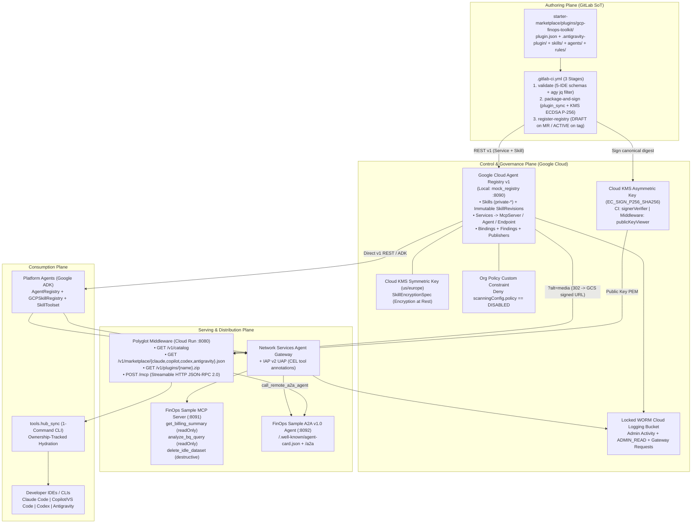
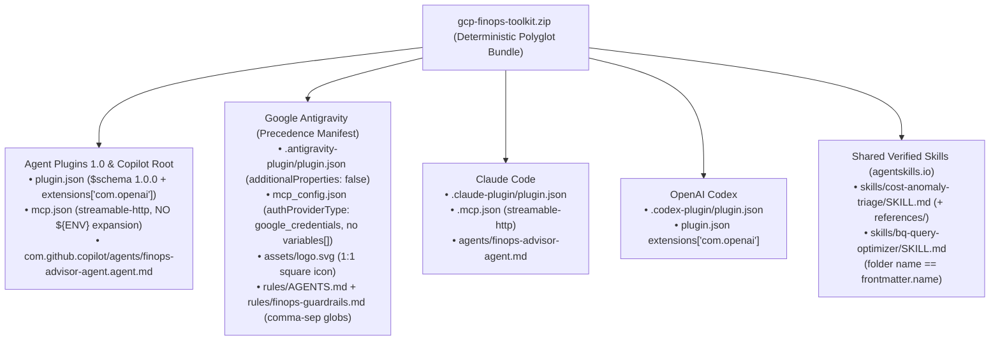
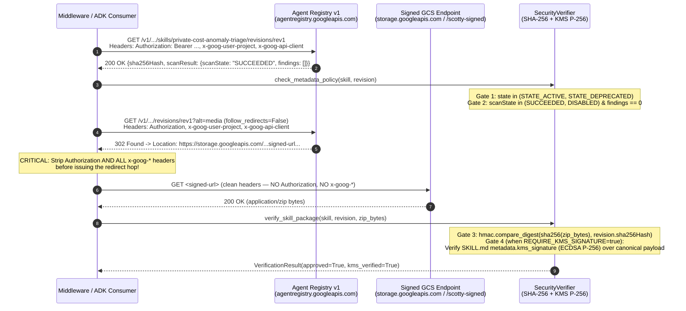
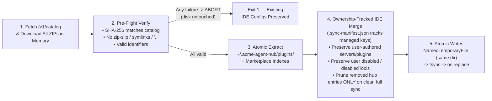
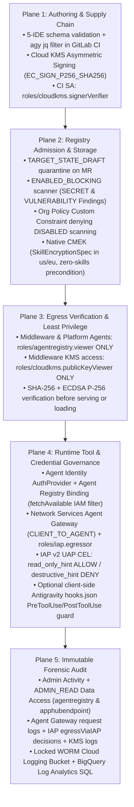

# Technical Architecture: Governed Polyglot Enterprise Agent Marketplace

This document details the engineering architecture of the **Enterprise Agent Marketplace Workshop** built on **Google Cloud Agent Registry (`v1` GA)**. All ports, resource names, URNs, and schemas match [WORKSHOP_SPEC.json](../WORKSHOP_SPEC.json).

---

## 1. End-to-End System Topology

### Component Ports & Defaults (`WORKSHOP_SPEC.json`)

| Service | Module / Directory | Local Port | Key Endpoints |
| :--- | :--- | :---: | :--- |
| **Mock Agent Registry (`v1`)** | [mock_registry/app.py](../mock_registry/app.py) | `8090` | `/v1/projects/{p}/locations/{l}/{services,agents,mcpServers,endpoints,skills,bindings,findings,publishers}`, `/scotty-signed/{token}`, `/_mock/reset` |
| **Sample FinOps MCP Server** | [samples/mcp-server/app.py](../samples/mcp-server/app.py) | `8091` | `/healthz`, `POST /mcp` (`get_billing_summary`, `analyze_bq_query`, `delete_idle_dataset`) |
| **Sample FinOps A2A Agent** | [samples/a2a-agent/app.py](../samples/a2a-agent/app.py) | `8092` | `/healthz`, `GET /.well-known/agent-card.json`, `POST /a2a`, `GET /a2a/tasks/{task_id}` |
| **Polyglot Marketplace Middleware** | [middleware/app/main.py](../middleware/app/main.py) | `8080` | `/healthz`, `/v1/catalog`, `/v1/marketplace/{claude,copilot,codex,antigravity}.json`, `/v1/plugins/{plugin_name}.zip`, `POST /mcp` |

---

## 2. Polyglot Single-Bundle ZIP Layout

When [middleware/app/polyglot_builder.py](../middleware/app/polyglot_builder.py) synthesizes `/v1/plugins/{plugin_name}.zip`, it groups all approved `STATE_ACTIVE` (and optionally `STATE_DEPRECATED`) skills sharing `frontmatter.metadata.plugin_name`, resolves linked `mcp_service_id` and `agent_service_id` resources from Agent Registry, and builds a **deterministic single ZIP** (sorted paths, fixed timestamp, `0644`/`0755` Unix permissions, strict zip-slip/symlink rejection) that passes validators for **all five targets simultaneously**:

### Critical Cross-IDE Coexistence Invariants
1. **No brand prefix violations**: Antigravity rejects plugin names starting with `antigravity`, `gemini`, `claude`, or `cursor` (`sanitize_kebab_name()`).
2. **Sanitized MCP server keys**: Keys match `^[a-zA-Z0-9_-]{1,20}$` (dots replaced with hyphens) so `<plugin-name>_<server>` / `mcp_<server>_<tool>` validates cleanly (`sanitize_antigravity_mcp_key()`).
3. **Immediate enablement in Antigravity**: `mcp_config.json` uses `authProviderType: "google_credentials"` without `variables[]`, ensuring plugins install enabled immediately without manual variable prompts.
4. **Comma-separated `globs` string**: `rules/finops-guardrails.md` declares `globs: "**/*.sql, **/*.tf, **/*.yaml"` as a single string—never a YAML list.
5. **No `${ENV}` expansion in `mcp.json`**: Agent Plugins 1.0 forbids `${VAR}` interpolation inside remote `url` or `headers`.

---

## 3. Critical `?alt=media` HTTP 302 Redirect & Verification Pipeline

Downloading a `SkillRevision` archive from Agent Registry `v1` is a **two-hop cross-origin flow** that breaks naive HTTP clients (`follow_redirects=True` forwarding Google headers to GCS signed URLs causes HTTP 403/400 rejection). Both [middleware/app/registry_client.py](../middleware/app/registry_client.py) and [platform_agent/rest_consumer.py](../platform_agent/rest_consumer.py) implement explicit redirect handling and fail-closed cryptographic verification:

> **Local Workshop Fidelity:** [mock_registry/app.py](../mock_registry/app.py) simulates this exact behavior via `/scotty-signed/{token}`, returning **HTTP 403** if any `x-goog-*` or `Authorization` header leaks onto the redirect target!

---

## 4. Safe Ownership-Tracked Workstation Hydration (`tools.hub_sync`)

Corporate developer laptops hold customized personal IDE configurations. [tools/hub_sync/hydration.py](../tools/hub_sync/hydration.py) and [tools/hub_sync/adapters.py](../tools/hub_sync/adapters.py) enforce five strict safety invariants:

### Files Managed per IDE Target (`--home <HOME>`)

| Target | Hub Index / Config Files Written | User-Safety Guarantee |
| :--- | :--- | :--- |
| **Shared Hub** | `<HOME>/.acme-agent-hub/.sync-manifest.json`, `<HOME>/.acme-agent-hub/plugins/<name>/` | Atomic directory swap; pruning disabled on partial failure or `--bootstrap-mcp-only` |
| **Claude Code** | `<HOME>/.acme-agent-hub/.claude-plugin/marketplace.json`, `<HOME>/.claude/settings.json` | Merges `extraKnownMarketplaces` & `enabledPlugins`; preserves pre-existing keys and user `false` toggles |
| **VS Code / Copilot** | `<HOME>/.acme-agent-hub/marketplace.json`, `.github/plugin/marketplace.json`, `vscode-settings-snippet.json`, optional `~/.config/Code/User/settings.json` (`--apply-vscode`) | Preserves existing `chat.plugins.marketplaces` and user `chat.pluginLocations` entries |
| **OpenAI Codex** | `~/.agents/plugins/marketplace.json`, `~/.agents/plugins/plugins/<name>` (symlinks), `~/.codex/agents/<agent>.toml`, `~/.codex/config.toml` | Preserves user-authored `[mcp_servers.*]`, user agent `.toml` files, and user plugin directories |
| **Google Antigravity** | `<HOME>/.acme-agent-hub/antigravity-marketplace.json`, `~/.gemini/config/mcp_config.json`, `~/.gemini/config/plugins/<name>`, optional `agy plugin install` (skipped with `--no-exec`) | Preserves user-authored MCP servers and user `disabled`/`disabledTools` overrides; skips pre-existing unmanaged plugin folders |

---

## 5. Security Defense-in-Depth Planes (Workstream B)

### Canonical Separation of Identities

| Identity | Terraform Module | Agent Registry Role | Cloud KMS Role | Purpose |
| :--- | :--- | :--- | :--- | :--- |
| **Polyglot Middleware SA** (`agent-marketplace-middleware`) | `terraform/core` + `security_governance` | `roles/agentregistry.viewer` | `roles/cloudkms.publicKeyViewer` | Reads active skills/services, verifies signatures, serves IDE feeds |
| **CI Publisher SA** (`agent-registry-ci-publisher`) | `terraform/core` + `security_governance` | `roles/agentregistry.editor` | `roles/cloudkms.signerVerifier` | Uploads Services & Skills from GitLab CI, signs skill digests |
| **Standalone Skill Author SA** (`agent-registry-skill-author`) | `terraform/core` | `roles/agentregistry.user` | *(none)* | Standalone skill CRUD only (cannot mutate `Service` registrations) |
| **Agent Registry P4SA** (`service-<NUM>@gcp-sa-agentregistry.iam.gserviceaccount.com`) | `terraform/core` + `security_governance` | *(Google-managed)* | `roles/cloudkms.cryptoKeyEncrypterDecrypter` | Imports GCS-staged skills (`roles/storage.objectViewer`) & encrypts skills at rest via CMEK |
| **Security Admin** (Human / SecOps group) | Organization / Project | `roles/agentregistry.admin` | KMS Admin | Manages `Bindings`, `Findings`, per-`Skill` IAM, `SkillEncryptionSpec`, Org Policies |
| **Sample Workloads SA** (`finops-sample-workloads`) | `terraform/core` | *(none — zero Agent Registry IAM)* | *(none)* | Runs sample MCP server & A2A agent with zero registry privileges |
